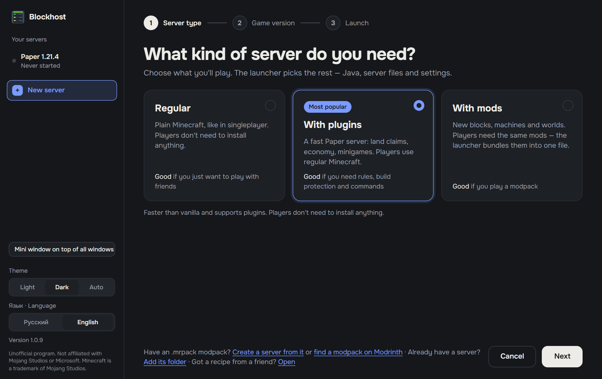
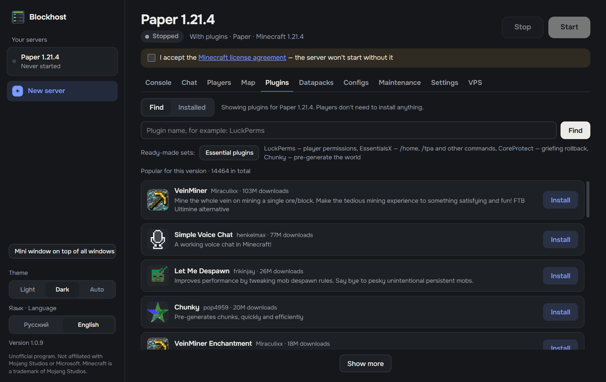
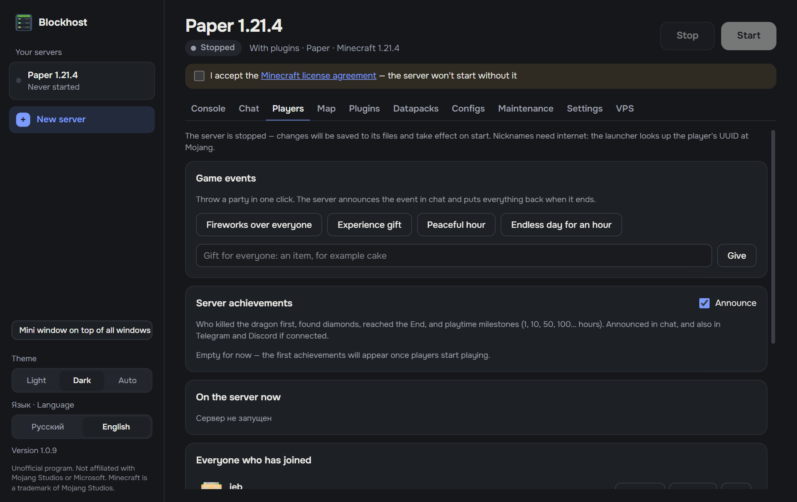

# Blockhost

**Your own Minecraft server on your PC — in a couple of clicks, no console, no router setup.**
Pick what you want to play and press Start: Java, server files and mods are downloaded for you.
Friends can join even if you don't have a public IP.

[Русская версия](README.md)

  <a href="https://github.com/averagev0n/mc-server-launcher/releases/latest/download/MC-Server-Launcher-Setup.exe"><b>⬇ Download for Windows</b></a>
  &nbsp;·&nbsp;
  <a href="https://github.com/averagev0n/mc-server-launcher/releases/latest/download/MC-Server-Launcher-Portable.exe">Portable version</a>
  &nbsp;·&nbsp;
  <a href="../../releases">What's new</a>

## Why Blockhost

- **Free, no queues.** The server runs on your PC: no hosting fees and no waiting in line like on free hosting sites.
- **Friends can join without a public IP.** The built-in playit.gg tunnel works even behind carrier-grade NAT. UPnP and an open-port check are included.
- **Mods without the pain.** Search Modrinth with dependencies resolved. For friends, one button: the modpack opens in Modrinth App, or they get a single .mrpack file.
- **Your world is safe.** Backups before start, on a schedule and before updates, with one-click restore.
- **Tells you what broke.** Server errors are explained in plain words. The launcher finds the mod that crashes the server and explains "mod mismatch" errors.
- **Doesn't waste resources.** Sleep mode stops the server when nobody is online and wakes it up when someone joins.

## Screenshots

| Mods and plugins from Modrinth | Players and events |
|---|---|
|  |  |

## Getting started

1. Download the [installer](https://github.com/averagev0n/mc-server-launcher/releases/latest/download/MC-Server-Launcher-Setup.exe) and run it.
   Windows may show "Windows protected your PC": the app doesn't have a paid code signature yet. Click "More info" → "Run anyway".
2. Click "New server" and choose the server type and game version.
3. Tick the box to accept the [Minecraft EULA](https://aka.ms/MinecraftEULA) and press Start.
4. In Settings, turn on internet access and send the address to your friends.

The interface language follows Windows; switch it at the bottom of the sidebar (Русский / English).

## Features

**Servers**
- Vanilla and Paper (plugins); Fabric, Forge and NeoForge mods; mods plus plugins with Arclight, Mohist, Youer.
- Create a server from an .mrpack modpack, an existing server folder or a "recipe" file from a friend.
- Picks and installs the right Java version, limits memory based on your RAM.

**Mods and plugins**
- Search and install from [Modrinth](https://modrinth.com) with dependencies, one-click updates.
- Edit plugin and mod configs in the app: a form with descriptions or plain text, with a backup.
- Client mod pack for players: an .mrpack file or straight into Modrinth App.
- Finds a broken mod by bisection and explains "mod mismatch" errors.

**Players and access**
- Who's online, operators, whitelist, bans — no commands needed. In-game events and server achievements.
- Internet access: playit.gg, UPnP, port check, external IP change tracking.
- Protection for offline-mode servers: AuthMe or EasyAuth.

**Reliability**
- World backups and one-click restore.
- Scheduled restarts with player warnings, restart after a crash.
- Sleep mode, CPU and memory monitoring, server health check.

**Remote control**
- Telegram bot: notifications, commands and a weekly report. Discord notifications.
- Control from your phone and a mini window on top of all windows.
- Move the server to a Linux VPS over SSH and manage it there.

Servers are stored in `C:\Users\<name>\MinecraftServers`.

## FAQ

**Is it safe?** The source code is public in this repository; the app is built from it and published on the [Releases](../../releases) page.

**Does my PC need to stay on?** Yes, while people are playing. For a 24/7 server, move it to a VPS right from the app.

## Disclaimer

Unofficial software. Not affiliated with or endorsed by Mojang Studios or Microsoft. Minecraft is a trademark of Mojang Studios.
