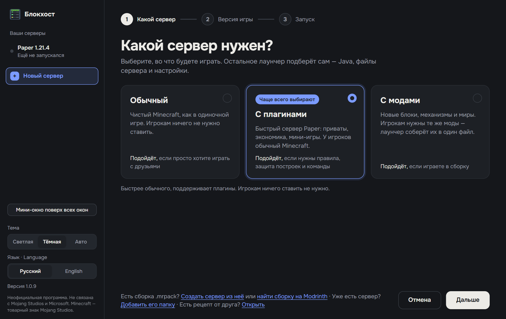
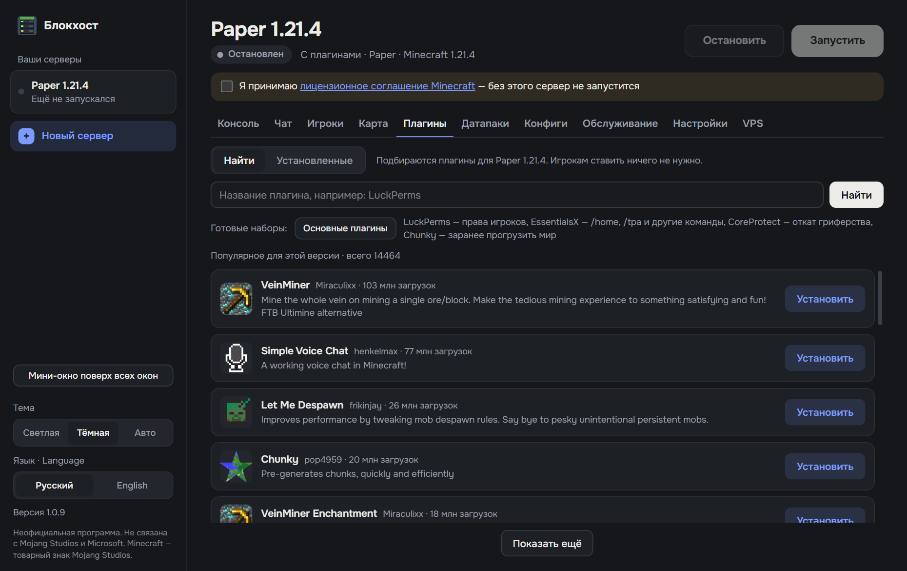
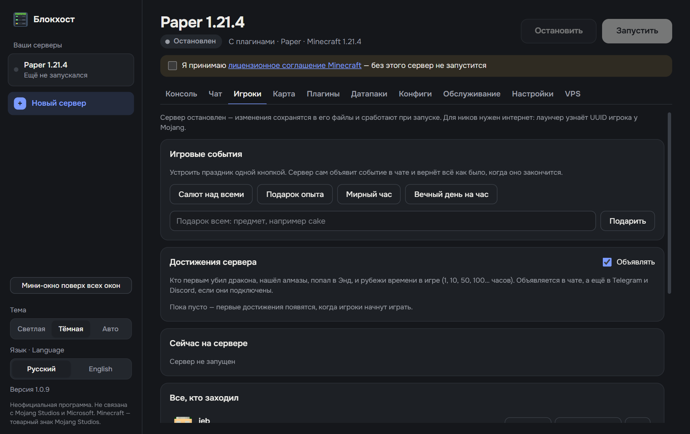

# Блокхост

**Свой сервер Minecraft на вашем компьютере — за пару кликов, без консоли и настройки роутера.**
Выбираете, во что играть, жмёте «Запустить» — Java, файлы сервера и моды скачаются сами.
Друзья подключаются даже без белого IP.

[English version](README.en.md)

<p align="center">
  <a href="https://github.com/averagev0n/mc-server-launcher/releases/latest/download/MC-Server-Launcher-Setup.exe"><b>⬇ Скачать для Windows</b></a>
  &nbsp;·&nbsp;
  <a href="https://github.com/averagev0n/mc-server-launcher/releases/latest/download/MC-Server-Launcher-Portable.exe">Портативная версия</a>
  &nbsp;·&nbsp;
  <a href="../../releases">Что нового</a>
</p>



## Почему Блокхост

- **Бесплатно и без очередей.** Сервер работает на вашем ПК: не нужно платить за хостинг или ждать в очереди, как на бесплатных сайтах.
- **Друзья зайдут без белого IP.** Встроенный туннель playit.gg работает даже за провайдерским NAT. Есть UPnP и проверка, открыт ли порт.
- **Моды без мучений.** Поиск на Modrinth с зависимостями. Друзьям — одна кнопка: сборка откроется в Modrinth App, или они получат один файл .mrpack.
- **Мир не пропадёт.** Резервные копии перед запуском, по расписанию и перед обновлением, восстановление в один клик.
- **Подскажет, что сломалось.** Ошибки сервера объясняются по-русски. Лаунчер сам найдёт мод, из-за которого сервер падает, и разберёт ошибку «моды не совпадают».
- **Не жрёт ресурсы впустую.** Спящий режим выключает сервер, когда никого нет, и включает, когда кто-то заходит.

## Скриншоты

| Моды и плагины с Modrinth | Игроки и события |
|---|---|
|  |  |

## Как начать

1. Скачайте [установщик](https://github.com/averagev0n/mc-server-launcher/releases/latest/download/MC-Server-Launcher-Setup.exe) и запустите.
   Windows может показать «Windows защитила ваш компьютер»: у программы пока нет платной цифровой подписи. Нажмите «Подробнее» → «Выполнить в любом случае».
2. Нажмите «Новый сервер», выберите тип и версию игры.
3. Поставьте галочку о принятии [лицензионного соглашения Minecraft](https://aka.ms/MinecraftEULA) и нажмите «Запустить».
4. Во вкладке «Настройки» включите доступ из интернета и отправьте друзьям адрес.

Установщик сам обновляется, когда выходит новая версия. Портативная версия работает без установки и сообщает о новых версиях, но скачивать их нужно вручную.

## Что умеет

**Серверы**
- Vanilla и Paper (плагины); моды на Fabric, Forge и NeoForge; моды вместе с плагинами — Arclight, Mohist, Youer.
- Сервер из готовой сборки .mrpack, из папки существующего сервера или из «рецепта» от друга.
- Подбор и установка нужной версии Java, ограничение памяти по объёму ОЗУ.

**Моды и плагины**
- Поиск и установка с [Modrinth](https://modrinth.com) вместе с зависимостями, обновление в один клик.
- Настройка плагинов и модов прямо в программе: форма с описаниями или текст, с резервной копией.
- Сборка клиентских модов для игроков: файл .mrpack или сразу в Modrinth App.
- Поиск сломанного мода делением пополам и разбор ошибки «моды не совпадают».

**Игроки и доступ**
- Кто онлайн, операторы, белый список, баны — без команд. Игровые события и достижения сервера.
- Доступ из интернета: playit.gg, UPnP, проверка порта, слежение за сменой внешнего IP.
- Защита для серверов без лицензии: AuthMe или EasyAuth.

**Надёжность**
- Резервные копии мира и восстановление в один клик.
- Перезапуск по расписанию с предупреждением игроков, перезапуск после падения.
- Спящий режим, мониторинг процессора и памяти, проверка «здоровья» сервера.
- Понятные объяснения ошибок сервера с подсказками, что делать.

**Управление издалека**
- Telegram-бот: уведомления, команды и отчёт за неделю. Уведомления в Discord.
- Управление с телефона и мини-окно поверх всех окон.
- Перенос сервера на VPS с Linux по SSH и управление им там.

Интерфейс на русском и английском. Серверы хранятся в папке `C:\Users\<имя>\MinecraftServers`.

## Вопросы

**Это безопасно?** Код открыт — его можно проверить в этом репозитории. Программа собирается из него и публикуется на странице [Releases](../../releases).

**Нужна ли лицензия Minecraft?** Для игры на сервере — как обычно. Можно запустить сервер и для игроков без лицензии; тогда лаунчер предложит поставить защиту паролем.

**Мой компьютер должен быть включён?** Да, пока на сервере играют. Если нужен сервер круглосуточно, его можно перенести на VPS прямо из программы.

## Для разработки

```bash
npm install
npm start
```

Выпуск новой версии:

1. Допишите сверху в [CHANGELOG.md](CHANGELOG.md) раздел `## 1.2.3 — ГГГГ-ММ-ДД` со списком изменений.
2. Закоммитьте остальные изменения.
3. Выполните `npm run release -- 1.2.3`.

Скрипт поставит версию, соберёт установщик и портативную версию и опубликует выпуск на GitHub с описанием из CHANGELOG.md. Установленные копии лаунчера увидят обновление и покажут, что нового.

## Отказ от ответственности

Неофициальная программа. Не связана с Mojang Studios и Microsoft и не одобрена ими. Minecraft — товарный знак Mojang Studios.
